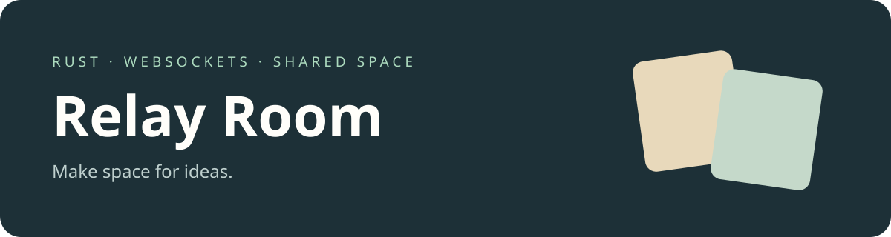

# Relay Room

**English** · [Русский](#русский)

A shared board and focus timer built with Rust, WebSockets and a lightweight browser interface.

> Early implementation. The cover is an illustration, not a screenshot. Rooms currently work across tabs on the same computer and reset when the server stops.

## Run

Install [Rust and Cargo](https://rustup.rs/), then run `cargo run --release` and open <http://127.0.0.1:3001>. On Windows use `run.bat`; on macOS use `sh run.command`. Open the same room link in a second tab to share cards and the timer. The server binds to localhost, so a link does not work on another person's computer. Stop with Ctrl+C.

Use **New room** to generate a fresh room, add cards, mark them done, delete them, and start or stop the shared 25-minute timer. Language and theme preferences stay in your browser. Rooms have no login, storage or permission controls; anyone with the local room link can edit it. Do not store sensitive information here.

## Русский

Общая доска и таймер для совместной работы: Rust, WebSocket и лёгкий интерфейс в браузере.

> Ранняя версия. Обложка — иллюстрация. Сейчас комнаты работают между вкладками на одном компьютере и очищаются при остановке сервера.

Установите [Rust и Cargo](https://rustup.rs/), выполните `cargo run --release` и откройте <http://127.0.0.1:3001>. В Windows можно запустить `run.bat`, на macOS — `sh run.command`. Откройте ссылку комнаты во второй вкладке: карточки и таймер общие. Сервер работает только на локальном компьютере — на другом устройстве ссылка пока не откроется. Остановка — Ctrl+C.

Создавайте комнату, добавляйте и отмечайте карточки, запускайте общий таймер на 25 минут. Язык и тема сохраняются в браузере. Авторизации и постоянного хранения пока нет; любой человек с локальной ссылкой может менять доску. Не храните в ней конфиденциальные данные.
